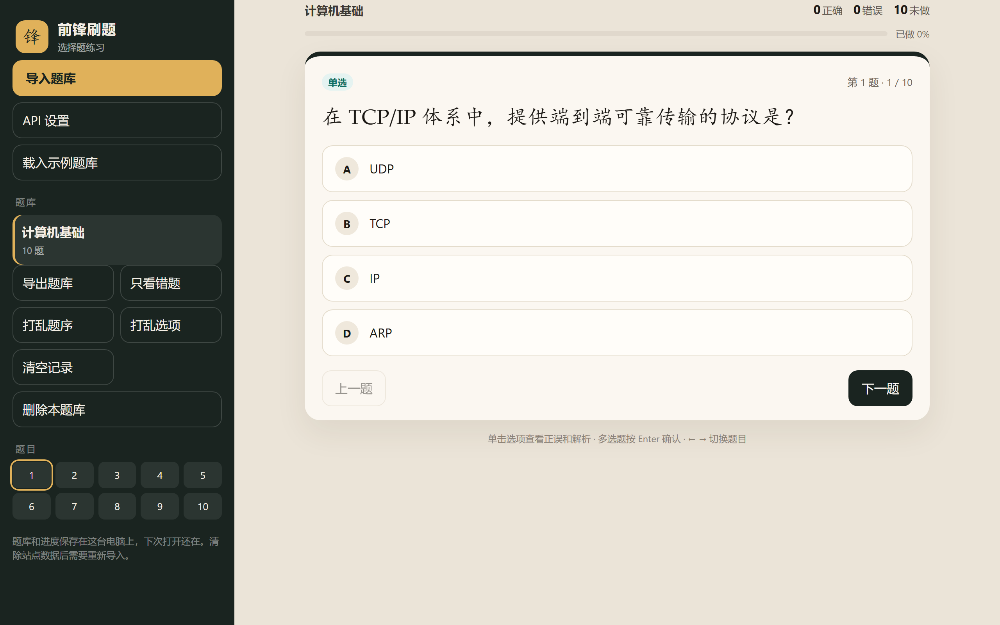
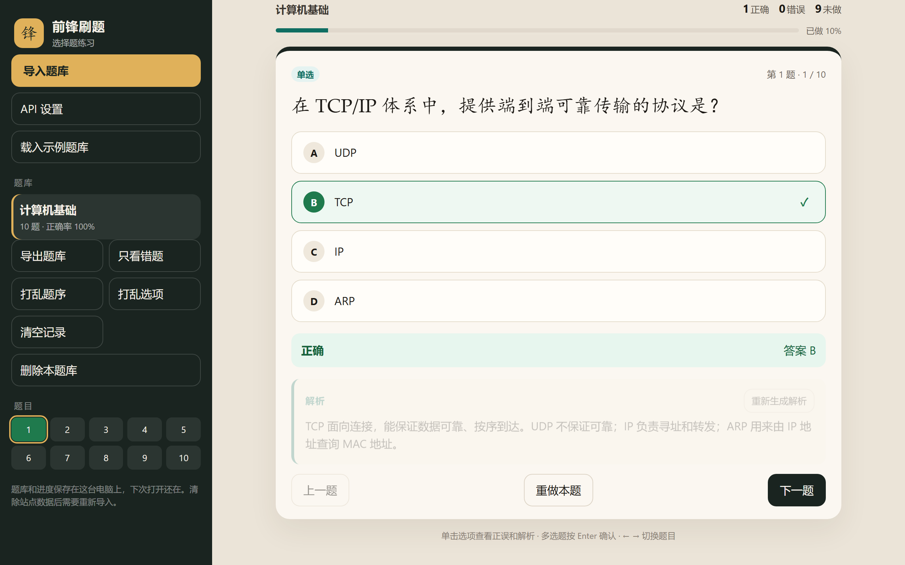
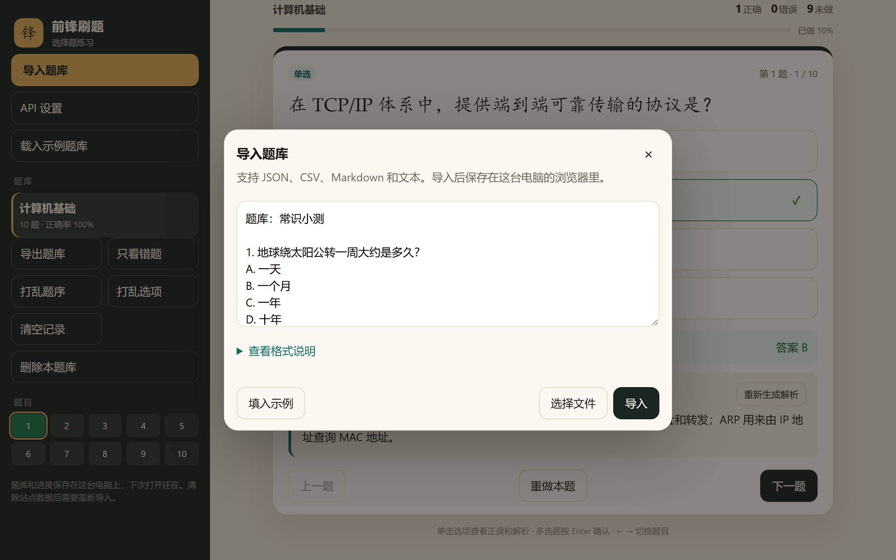

<h1 align="center">前锋刷题软件 / Qianfeng Shuati</h1>

<p align="center">
  解压即用的 Windows 选择题练习。侧边栏切换<strong>刷题</strong>或<strong>考试</strong>，导入 Markdown / JSON，搜索、收藏、成绩档案，可备份进度。<br>
  不用注册，数据只在你的电脑上。
</p>

<p align="center">
  
  
  
</p>

<p align="center">
  <a href="how-to.html">怎么用</a>
  ·
  <a href="#online-demo">在线演示</a>
  ·
  <a href="https://github.com/Tom713134/qianfeng-shuati/releases/latest">下载</a>
  ·
  <a href="#english">English</a>
  ·
  <a href="LICENSE">MIT</a>
</p>

<p align="center">
  
</p>

## 功能

- **刷题模式**：点选项立刻显示对错和解析；可搜索本题库，按错题或收藏筛选
- **考试模式**：答题中不显示对错；可选题量、时限、打乱题序/选项；交卷后出分，写入成绩档案，可回看；右键可删除成绩
- 侧边栏「设置」里导入 / 导出题库、编辑题目、填写 API；导入 JSON、Markdown、CSV、纯文本或本软件备份文件
- 单选 / 多选；题目可收藏
- 打乱题序、打乱选项（解析会跟当前选项对齐）
- 导出时可选择内容（题库 / 记录 / 成绩 / 收藏）和保存位置
- 进度保存在本机，下次打开还在
- 可选：填自己的 API Key（DeepSeek / OpenAI / Ollama）生成解析

不填 Key 也能完整刷题、考试。

<p align="center">
  
</p>

<h2 id="online-demo">试用</h2>

打开本仓库的 **GitHub Pages**（仓库右侧 About 的 Website）即可在浏览器里刷示例题，不用安装。第一次会载入「计算机基础」示例。

网页版进度只存在当前浏览器。要导入自己的试卷、并让进度跟着 Windows 配置走，请用下面的绿色版。

## Windows 打开

1. [下载 Releases 里的 zip](https://github.com/Tom713134/qianfeng-shuati/releases/latest)（或克隆本仓库）
2. 解压后**保留整个文件夹**
3. 双击带图标的 **前锋刷题** 快捷方式（推荐）。没有快捷方式时双击 `start.bat` 或 `open.vbs`（首次运行会自动生成「前锋刷题」快捷方式）

需要 Windows 10/11，以及 Edge 或 Chrome。不必安装 Node 或其他运行时。

从 QQ / 微信 / 网盘下载后，若提示「Windows 已保护你的电脑」：点 **更多信息 → 仍要运行**。或右键 `start.bat` / `open.vbs` → 属性 → **解除锁定**。

更完整的说明见 [how-to.html](how-to.html)。

## 刷题和考试

打开后，侧边栏顶部切换模式：

| 模式 | 做什么 |
| --- | --- |
| 刷题 | 即时对错和解析，适合日常过题；可搜索、只看错题或收藏 |
| 考试 | 先选题量和时限再开考；过程中看不到答案，交卷后出分并写入成绩档案 |

考试进行中不能改模式。交卷或看完卷后，可回到刷题。

## 导入题库

打开后把文件拖进窗口，或点侧边栏「设置」→「题库设置」→「导入」。支持 JSON、Markdown、CSV 和纯文本。

<p align="center">
  
</p>

仓库只带示例，用来确认导入是否正常：

- [`questions/sample-questions.json`](questions/sample-questions.json)
- [`questions/sample-questions.txt`](questions/sample-questions.txt)

自己的试卷请在软件里导入，**不要把课内卷、作业或带版权的题目提交进本仓库**。

## 数据存在哪

做题记录、导入的题库、API Key 都在这台电脑上：

- 浏览器配置：`%APPDATA%\QianfengShuati`
- Key 只发给你在「API 设置」里填写的接口，不会发到本项目的服务器
- 关掉窗口即退出，没有后台服务

若本机以前用过旧版「刷题」，第一次打开会自动沿用原来的进度。

换电脑时在软件里打开「设置 → 题库设置 → 导出」，勾选完整备份后再导入到新电脑。

## 开发

```text
qianfeng-shuati/
  index.html                         页面
  app.js                             逻辑（含导入解析）
  styles.css                         样式
  server.ps1                         本机静态服务 + API 代理
  start.bat / open.vbs               英文启动入口
  前锋刷题.lnk                       中文快捷方式（首次运行自动生成）
  questions/                         仅示例题
  docs/                              README 截图与社交预览图
  .github/workflows/                 Pages 与 Windows zip
```

在仓库根目录双击启动即可。`app.js` 可用 Node 跑自检：

```bat
node app.js --test
```

GitHub Pages 由 `.github/workflows/pages.yml` 在推送到 `main` 后发布。打 `v*` 标签会打包 Windows zip 到 Releases。

<h2 id="english">English</h2>

**Qianfeng Shuati** is a portable Windows quiz app for multiple-choice practice. Switch between **practice** (instant feedback, search, favorites) and **exam** (optional timer, score archive after submit). Import JSON / Markdown / CSV / text, export a backup, review missed questions, optionally shuffle stems and options. Progress stays on this computer. No account.

<p align="center">
  
</p>

**Try in the browser:** the GitHub Pages site (Website in the repo About). Sample questions load on first visit.

**Run on Windows:** unzip the folder from [Releases](https://github.com/Tom713134/qianfeng-shuati/releases/latest), then double-click `start.bat` or `open.vbs`. Windows 10/11 with Edge or Chrome.

If SmartScreen says Windows protected your PC: **More info → Run anyway**, or unblock the `.vbs` / `.bat` from Properties.

Sample banks are in `questions/`. Do **not** commit copyrighted course exams.

MIT licensed. See [how-to.html](how-to.html) for the Chinese walkthrough.
